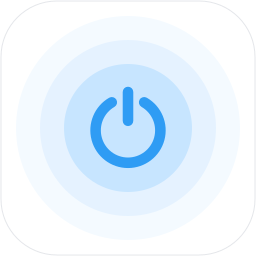
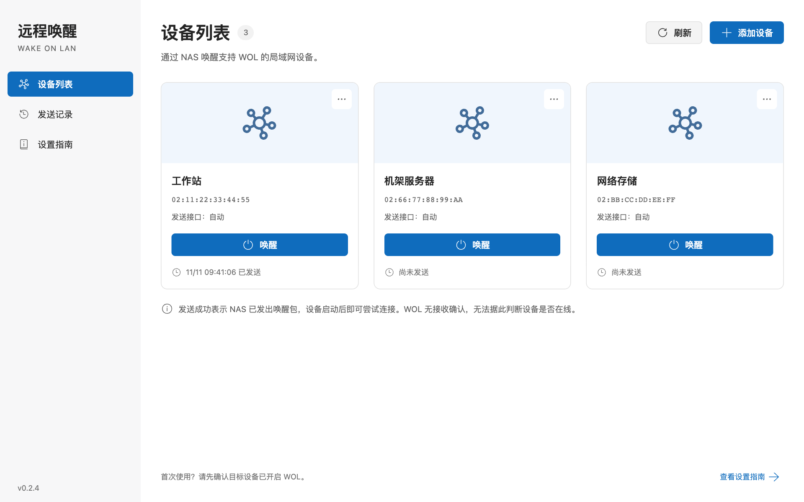
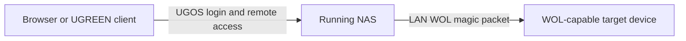

# ugos-wol

[简体中文](README.md) | **English**



Wake devices that support **Wake-on-LAN (WOL)** on your local network through a UGREEN NAS.

Reuse the remote access your NAS already provides: open the app in the UGREEN client from outside your network, and let the NAS send a standard magic packet locally. If you can already access your NAS remotely, there is no need to obtain a public IP address, configure port forwarding, deploy a tunnel, or set up another relay device just for WOL. See [UGREEN's native app remote access documentation](https://developer.ugnas.com/doc/backend/application/app-port.html).

Targets can include workstations, servers, network storage, and other WOL-capable devices. This app wakes other devices, not the NAS hosting it. The NAS must remain running, and WOL must be enabled in the target device's hardware and operating system settings.

## Advantages and alternatives

**Put the NAS that already stays on to work as your wake-up relay.** A NAS that runs continuously on your LAN is well suited to sending WOL packets. ugos-wol packages this capability as a native UGOS app, using your existing NAS account, remote access, and mobile client. See [UGREEN's remote access documentation](https://developer.ugnas.com/doc/backend/application/app-port.html).

Open Remote Wake in the UGREEN client, select a device, and send the wake request. You do not need to leave another computer running, buy a dedicated wake-up dongle, host a separate web service, remember IP addresses and ports, configure a domain, or build another remote access path for WOL.

The comparison below assumes you already own a UGREEN NAS and want to wake local devices while away. It focuses on the hardware involved, everyday mobile access, and additional setup.

| Approach | Packet sender | Mobile access | Setup and usage requirements |
| --- | --- | --- | --- |
| **ugos-wol** | **The UGREEN NAS you already keep running** | **Open the app inside the UGREEN client and select a device** | Install the native app and add the target MAC address. Reuse UGOS login and remote access, with no extra relay hardware, overlay network, or tunnel service 🙂 ✅ |
| Basic LAN-only WOL tool | A phone or computer in the same broadcast domain | Open a WOL tool and send locally | Local broadcasts alone do not provide remote wake-up from outside the network. A remote entry point and a local packet sender must be arranged separately 🙁 ❌ |
| [UU Remote assisted wake-up](https://uuyc.163.com/help/20241203/40220_1197682.html) | An online Windows/macOS computer or Android device on the same LAN; UU accelerator hardware and compatible routers are also supported | UU Remote client | The standard approach needs another computer or Android device running UU Remote continuously. Computers must stay awake; Android devices need continuous power and background-process settings. Router support depends on compatibility 🙁 ❌ |
| [Dedicated wake-up dongle, such as Sunlogin's LAN model](https://service.oray.com/question/30535.html) | A separately purchased dongle that stays powered and connected | Vendor app | Requires additional hardware, power, network connectivity, and association with a vendor account and target devices 🙁 ❌ |
| [Self-hosted WOL web app on a NAS, such as UpSnap](https://github.com/seriousm4x/UpSnap) | Can use an existing NAS | A separate web page in a browser | Requires service deployment, authentication, and remote access setup. Everyday use involves a separate browser entry point, URL or bookmark, and service login to manage 🙁 ❌ |
| [Tailscale + UpSnap or a local WOL tool](https://tailscale.com/blog/wake-on-lan-tailscale-upsnap) | A NAS, Raspberry Pi, or another host that stays on | Connect to Tailscale, then open a wake-up page or tool | No public IP is normally needed, but the overlay network, WOL tool, and permissions need deployment and maintenance. Everyday use depends on the overlay connection and a separate tool; web access adds a URL or bookmark to manage 🙁 ❌ |
| [WOL web service + Cloudflare Tunnel](https://developers.cloudflare.com/learning-paths/clientless-access/connect-private-applications/) | Can use a NAS or another host that stays on | Visit a configured domain in a browser | No public IP is needed, but the WOL service, tunnel, domain, and authentication must be assembled and maintained. A separate browser entry point and its authentication still need to be managed 🙁 ❌ |
| [Router-integrated WOL](https://www.asus.com/global/support/faq/1011268/) | A router with WOL support | Router app or web interface, depending on the model | Model and firmware support vary. Local WOL and remote management access must both be checked. With web-based access, users open the router management page in a browser and navigate to its wake-up feature 🙁 ❌ |
| [Public UDP forwarding + DDNS](https://www.tp-link.com/us/support/faq/923/) | A router supporting the required forwarding configuration | A WOL tool using a public address or domain | Usually requires an inbound-reachable public address, port forwarding, and address binding or static ARP. Dynamic addresses may also need DDNS. Available settings depend on the router 🙁 ❌ |

**Remote wake-up should take just a few taps.** Open the UGREEN client, launch Remote Wake, and select a device to send the request. The NAS handles packet transmission in the background, keeping service addresses, ports, and overlay connections out of your everyday workflow.

A bookmark saves typing a URL, but a standalone web service still has its own entry point and login state to manage. Some web solutions can also run on a NAS. ugos-wol brings installation, authentication, and remote access into UGOS, so there is one less separate service to look after.

These advantages assume a compatible UGREEN NAS that remains running and is already accessible through UGREEN remote access. The app currently requires a NAS administrator account. All WOL approaches require the target device to support and have the relevant wake-up functionality enabled. The NAS sending interface and target NIC must be in the same broadcast domain. If an existing router or overlay network setup already meets your needs, you can continue using it without duplicating that setup.

“No additional network configuration” refers to the remote entry point for wake-up. The target device's WOL settings and subsequent remote desktop, SSH, or streaming connections must still be prepared separately. This app does not tunnel those connections.

## Features

- **LAN wake-up:** save the target NIC's MAC address; no target IP address is required.
- **Multiple interfaces and subnets:** broadcast through available LAN interfaces automatically, or select a specific sending interface.
- **Remote access:** open the app through UGREEN remote access while the NAS sends packets locally.
- **Device and history management:** save up to 32 devices and retain the latest 100 transmission records, including the acting user.
- **UGOS identity integration:** use the current NAS administrator identity without another app account or password.
- **Native deployment:** a static Go backend with bundled frontend assets. No Docker or external icon service is required. The app currently provides a Chinese-language interface for desktop and mobile.

## Preview



## How it works



“Sent” means the NAS has transmitted the packets. WOL has no receipt acknowledgement, so a successful send does not confirm that the target has started or is online.

Once the device wakes, connect using your configured remote desktop, SSH, management interface, or streaming software. UU Remote and Sunshine + Moonlight are examples of separate tools you can use alongside this app. Their connection traffic does not pass through ugos-wol.

## Requirements

| Item | Requirement |
| --- | --- |
| NAS system | UGOS Pro with native UPK support; the package configuration declares a minimum firmware version of `1.13.0.0000` |
| NAS architecture | Separate `amd64` and `arm64` builds; choose the `nasync` package matching your NAS architecture |
| Account | NAS administrator; administrators on the same NAS share the device list and transmission history |
| Target device | NIC, firmware, and target power state must support wake-up using standard WOL magic packets |
| Network | The NAS sending interface and target NIC must share an IPv4 broadcast domain |

WOL support depends on the target hardware and system. Having a network interface does not guarantee wake-up support. Wireless connections, USB NICs, expansion devices, and sleep, hibernation, and shutdown states require separate verification.

Hardware validation currently focuses on amd64 NAS devices. ARM64 builds are supported, but still need hardware validation. See [Compatibility](docs/COMPATIBILITY.md) for differences in firmware role fields and application isolation. Supporting guides are currently in Chinese.

## Installation and use

1. Manually install the UPK matching your NAS architecture in the UGOS App Center. See [UGREEN's development preparation guide](https://developer.ugnas.com/doc/backend/quick-start/prepare.html) for authorization and signing requirements for self-developed packages.
2. Sign in to the UGOS desktop or UGREEN client as an administrator, then open the app named “远程唤醒” (Remote Wake).
3. Add a device with its name, target NIC MAC address, and sending interface. By default, all available LAN interfaces are used automatically.
4. Test local wake-up in a power state supported by the target device, then verify access through UGREEN remote access.

Preparation instructions for Windows, Linux, macOS, and other devices are available in the in-app “设置指南” (Setup Guide) and the [Device Setup Guide](docs/DEVICE-SETUP.md).

## Permissions and data

The frontend obtains a login token through the official UGOS SDK, and the system gateway verifies the user's identity. The backend listens only on loopback, requires an authenticated administrator identity, and does not directly expose a service port to the LAN.

Device configuration and transmission history are stored in `state.json` in the application's data directory using atomic file replacement. This data is shared by administrators on the same NAS. Uninstallation removes the application data directory; back up this file first if you want to retain your configuration.

## Build from source

Requirements: **Go 1.26.11** and the official **ugcli 1.1.0.25 or later**. Node.js/npm is also required when rebuilding the frontend. See [Compatibility](docs/COMPATIBILITY.md) for the reason Go is pinned.

### Frontend and backend

```bash
npm --prefix frontend ci
npm --prefix frontend run build

(cd backend && go test ./...)
TARGET_ARCH=all bash scripts/build-binaries.sh
```

`TARGET_ARCH` accepts `amd64`, `arm64`, or `all`. Both architectures are built by default. Output is written to `packaging/rootfs_amd64/bin/` and `packaging/rootfs_arm64/bin/`, respectively.

### UPK packages

Release UPKs must be generated with the official tooling on an **x86_64 Linux packaging host**. The packaging host architecture and target NAS architecture are separate choices.

```bash
# Test, build, and package both NAS architectures
TARGET_ARCH=all REBUILD_UI=1 BUILD_NUMBER=2 bash scripts/build-upk.sh

# Package existing binaries for the selected target architecture
TARGET_ARCH=arm64 BUILD_NUMBER=2 bash scripts/pack-prebuilt.sh
```

Use `UGCLI_TOOL` to specify the official tool's path. UPKs are exported to the build user's `~/Downloads/` by default; override this with `UPK_OUTPUT_DIR`. All target files are checked before export, and existing packages are not overwritten. Increment `BUILD_NUMBER` when publishing another build of the same version.

The repository retains the built frontend assets needed by Go embedding. Dependency directories, runtime data, backend executables, and UPKs are not tracked.

## Project structure

```text
backend/       Go HTTP service, WOL transmission, authentication, and tests
frontend/      UI source, official SDK integration, and local icon assets
packaging/     UGOS configuration, shared assets, and per-architecture output
scripts/       Cross-compilation, packaging, export, and compatibility tools
docs/          Device setup, compatibility, validation, and third-party notices
```

## Development and feedback

After editing the frontend, run its build to synchronize `backend/web/` and `packaging/rootfs_common/www/`. Backend changes should pass `go test ./...`. Device management and authentication changes should also be checked for existing configuration compatibility, administrator permissions, and desktop/mobile behavior.

Run the offline packaging selection, export, and overwrite-protection checks with Python 3: `python3 scripts/tests/test_packaging.py`. These checks create only temporary fixtures; they do not invoke the real packaging tool or generate release packages.

When reporting compatibility issues, include the NAS model, CPU architecture, UGOS firmware version, target device's WOL support, and exact error. See [Validation](docs/VALIDATION.md) for the scope of testing.

## License

This project is licensed under the [MIT License](LICENSE). License information and sources for the UGOS SDK, Fluent System Icons, and Go runtime are listed in [Third-party Components](docs/THIRD-PARTY.md). This is a third-party application; its relationship with UGREEN is limited to platform integration.
