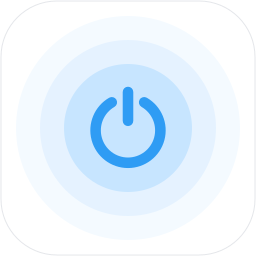
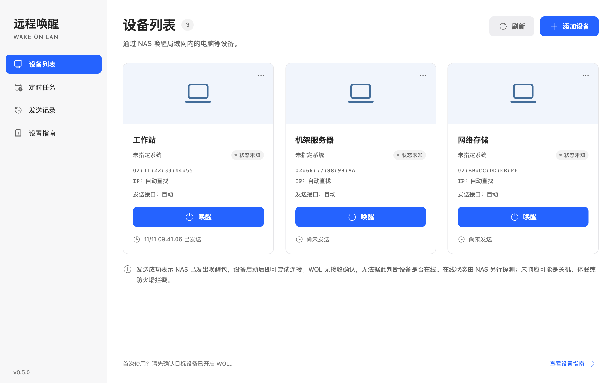
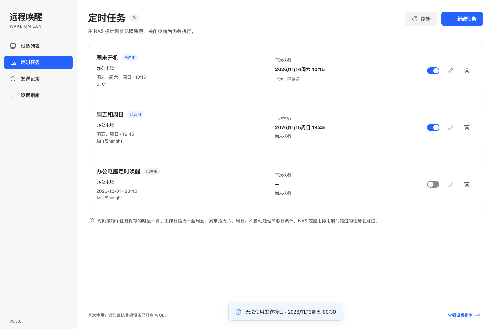

# ugos-wol

**简体中文** | [English](README.en.md)



通过绿联 NAS 远程唤醒局域网内支持 **Wake-on-LAN（WOL）** 的电脑等设备。

复用绿联 NAS 已有的远程访问能力：在外通过绿联客户端打开应用，由 NAS 在局域网内发送标准魔术包。对于已经能够远程访问 NAS 的用户，无需为 WOL 额外申请公网 IP、配置端口映射或部署内网穿透服务，也无需单独准备一台唤醒中继设备。[绿联原生应用远程访问说明](https://developer.ugnas.com/doc/backend/application/app-port.html)

目标可以是支持 WOL 的台式电脑、笔记本、服务器、NAS 等设备；本应用不用于唤醒承载它的 NAS。NAS 需要保持运行，目标设备仍需完成硬件与系统的 WOL 设置。

## 方案优势对比

**让本来就常开的 NAS，成为远程唤醒的入口。** NAS 通常已经持续运行并接入局域网，适合代替另一台常开电脑承担 WOL 发包。ugos-wol 将这项能力做成 UGOS 原生应用，复用绿联 NAS 的登录账号、远程通道和手机入口。[绿联原生应用远程访问说明](https://developer.ugnas.com/doc/backend/application/app-port.html)

在绿联客户端里，打开“远程唤醒”、选择设备即可发起唤醒。无需为 WOL 另留一台电脑或购买开机棒，也无需自行部署网页服务、记住 IP 和端口、配置域名或单独搭建外网访问通道。

下面以“已有绿联 NAS，人在外网唤醒局域网设备”为场景，比较常驻设备的利用、日常操作入口，以及需要额外承担的配置。

| 方案 | 发包设备 | 手机操作入口 | 配置与使用门槛 |
| --- | --- | --- | --- |
| **ugos-wol** | **本来就常开的绿联 NAS** | **在绿联客户端内打开应用，选择设备唤醒** | 安装原生应用、添加目标 MAC；登录与外网入口复用 UGOS，无需额外中继硬件、组网或穿透服务 🙂 ✅ |
| 普通局域网 WOL 工具 | 同一广播域内的手机或电脑 | 打开 WOL 工具，在局域网内发送 | 单靠局域网广播无法直接从外网唤醒，离开网络后还需解决远程入口和本地发包 🙁 ❌ |
| [UU 远程辅助开机](https://uuyc.163.com/help/20241203/40220_1197682.html) | 同网常在线的 Windows / macOS 电脑或 Android 设备；另支持 UU 加速盒及已适配路由器 | 在 UU 远程客户端操作 | 常规方案需另留电脑或安卓设备常驻运行 UU 远程，电脑需防止休眠，安卓需保持供电并处理后台保活；路由器方案受适配范围限制 🙁 ❌ |
| [专用开机棒，以向日葵局域网版为例](https://service.oray.com/question/30535.html) | 额外购买并常驻联网的开机棒 | 在厂商 App 中操作 | 需添置硬件、供电联网，并绑定厂商账号和目标设备 🙁 ❌ |
| [NAS 自部署 WOL 网页，以 UpSnap 为例](https://github.com/seriousm4x/UpSnap) | 可利用已有 NAS | 通过浏览器访问单独的网页入口 | 需自行部署服务、配置身份验证与外网入口；日常需另开浏览器，通过独立网址或书签访问，并管理该服务的登录，操作入口较分散 🙁 ❌ |
| [Tailscale + UpSnap / 局域网发包工具](https://tailscale.com/blog/wake-on-lan-tailscale-upsnap) | NAS、树莓派或其他常开主机 | 接入 Tailscale 后，再打开唤醒网页或工具 | 免公网 IP，但需部署和维护组网、发包工具及权限；日常需先接入组网，再切换到网页或工具；使用网页时还需另行管理网址或书签，多一层操作入口 🙁 ❌ |
| [WOL 网页服务 + Cloudflare Tunnel](https://developers.cloudflare.com/learning-paths/clientless-access/connect-private-applications/) | 可利用 NAS 或其他常开主机 | 通过浏览器访问配置好的域名 | 免公网 IP，但需组合部署 WOL 服务、隧道、访问域名和身份验证；日常需另开浏览器，经独立域名或书签访问，并完成相应身份验证，入口与登录需单独管理 🙁 ❌ |
| [路由器内置 WOL](https://www.asus.com/global/support/faq/1011268/) | 支持 WOL 的路由器 | 使用路由器 App 或网页，依型号而定 | 受型号与固件支持限制，本地 WOL 和外网管理入口需分别确认；采用网页方式时，需另开浏览器访问路由器管理入口，并在管理界面中找到唤醒功能 🙁 ❌ |
| [公网 UDP 转发 + DDNS](https://www.tp-link.com/us/support/faq/923/) | 支持相关转发配置的路由器 | 在 WOL 工具中使用公网地址或域名发送 | 通常需要可入站公网地址、端口映射、地址绑定或静态 ARP；动态地址还可能需要 DDNS，配置受路由器能力限制 🙁 ❌ |

**远程唤醒，应该是随手点几下就能完成的事。** 打开绿联客户端，进入“远程唤醒”，选择设备发送唤醒指令。常开的 NAS 在后台完成发包，用户无需关心服务地址、端口或组网连接，让唤醒自然融入已有客户端的日常操作。

独立网页即使设了书签，也需要用户额外管理一个入口及其登录状态；书签省去了输入网址，却没有将它融入已有客户端的应用流程。部分网页方案同样能利用 NAS，ugos-wol 进一步把安装、身份认证和远程入口接入 UGOS，让用户少操心一套服务。

上述优势以已拥有兼容、常驻运行且能够通过绿联远程访问的 NAS 为前提；当前应用仅限 NAS 管理员使用。所有 WOL 方案都要求目标设备支持并启用相应唤醒功能，NAS 发送接口与目标网卡需处于同一广播域。若现有路由器或组网方案已满足需求，继续复用也无需重复搭建。

“无需额外网络配置”指唤醒的外网入口。目标设备的 WOL 设置，以及唤醒后的远程桌面、SSH 或串流连接仍需分别准备；本应用不提供这些连接的转发通道。

## 功能

- **定时唤醒**：一次性、每天、工作日、周末及自定义星期和时间；后台执行，支持时区、下次执行预览和启停管理。
- **在线状态**：由 NAS 探测设备网络响应，区分在线、未响应与状态未知；唤醒后自动复查。点击状态可查看原因与检测时间。
- **可选设备信息**：IP 地址和系统类型均可留空；支持 Windows、macOS、Linux 图标，未指定系统时沿用电脑图标。
- **局域网扫描**：添加设备时由 NAS 查找设备名称、IP 和 MAC，选择结果填入名称、MAC、IP 和发送接口，保留手动填写。
- **局域网唤醒**：保存目标网卡 MAC，无需填写目标设备 IP。
- **多网口、多网段**：自动向可用局域网接口广播，也可指定发送接口。
- **远程访问**：通过绿联远程访问打开应用，由 NAS 在本地网络发包。
- **设备与记录管理**：最多保存 32 台设备，保留最近 100 条发送记录及操作人。
- **UGOS 身份接入**：使用当前 NAS 管理员身份，无需额外注册或设置应用密码。
- **原生运行**：Go 静态后台、内置前端资源，无需 Docker 或外部图标服务；提供中文桌面和手机界面。

## 界面预览



## 工作方式


应用显示“已发送”表示 NAS 已发出数据包。WOL 没有接收确认，发送结果不能用来判断设备是否已启动或在线。

设备启动后，使用已经配置好的远程桌面、SSH、管理界面或串流软件连接。UU 远程、Sunshine + Moonlight 等属于可搭配的独立工具，连接流量不经过本应用。

## 使用要求

| 项目 | 要求 |
| --- | --- |
| NAS 系统 | 支持原生 UPK 的 UGOS Pro；配置声明最低固件为 `1.13.0.0000` |
| NAS 架构 | `amd64` / `arm64` 分别构建，安装时选择对应架构的 `nasync` 包 |
| 登录账号 | NAS 管理员；同一 NAS 的管理员共享设备列表和发送记录 |
| 目标设备 | 网卡、固件与目标电源状态支持标准 WOL 魔术包唤醒 |
| 网络 | NAS 发送接口与目标网卡处于同一 IPv4 广播域 |

支持 WOL 由目标硬件和系统决定，仅有网络接口并不代表能够被唤醒。无线网络、USB 网卡、扩展设备以及睡眠、休眠、关机等状态需分别验证。

当前实机验证集中在 amd64 NAS；ARM64 提供构建支持，仍需实机验证。固件角色字段、应用隔离环境等差异见 [兼容性说明](docs/COMPATIBILITY.md)。

## 安装与使用

1. 在 UGOS 应用中心手动安装与 NAS 架构匹配的 UPK。自开发安装包的授权与签名要求参见 [绿联开发准备](https://developer.ugnas.com/doc/backend/quick-start/prepare.html)。
2. 使用管理员账号登录 UGOS 桌面或绿联客户端，从应用图标打开“远程唤醒”。
3. 添加设备时，可直接手动填写，或切换到“局域网扫描”，选择 NAS 网段并扫描；选中结果后核对名称、MAC、IP 和发送接口再保存。手动填写默认自动使用所有可用局域网接口。
4. 在目标设备支持的电源状态下进行局域网唤醒测试，再验证通过绿联远程访问使用。

扫描会通过 DNS 反查、mDNS 和 NetBIOS 尝试获取设备名称；设备或网络没有提供名称时显示 IP，仍可自行命名。名称仅作识别提示，添加前请核对 MAC。扫描由 NAS 在所选接口发起，最多探测 NAS 所在的一个 `/24` 范围；较大网段会显示实际扫描范围。结果来自局域网邻居信息，可能包含缓存记录，不代表设备当前在线或支持 WOL。关机、隔离网络中的设备可能无法发现，仍可手动添加；扫描不会发送 WOL 魔术包，也不会自动保存设备。

IP 地址仅用于状态检测，不参与 WOL 发包；可留空，扫描选择时会自动填入。手填 IP 必须位于所选 NAS 局域网内；动态地址变化后可修改或清空。系统类型由用户选填，不根据 MAC 或名称推测。

扫描保留同一 MAC 下的不同 IP；无线中继可能转换或代答 MAC，因此共用 MAC 的结果会提示核对目标设备真实网卡地址，且保留已填写的 MAC。

状态检测使用有限的 TCP 连接探测（22、443、445、3389）及 UDP 9 响应。填写 IP 时按该地址检测，不会因中继改变网络侧 MAC 而阻断；未填 IP 时按 MAC 查找并核对对应关系。无需目标端代理、原始套接字或系统权限调整。未填 IP 时先查邻居表，必要时共享一次有限的局域网扫描（每个接口最多 NAS 所在 `/24`）。缓存记录本身不代表在线。设备页可见时约每 15 秒检测一次，发包后最多 60 秒内约每 5 秒复查；关闭页面后不持续轮询。在线表示检测地址有网络响应，不代表已登录或远程服务已就绪；未响应可能由关机、休眠或防火墙引起；未填 IP 且无法找到或确认 IP/MAC 时显示状态未知。明确填写 IP 时请确保该地址仍属于目标设备。

Windows、Linux、macOS 及其他设备的准备方式见应用内“设置指南”和 [设备准备指南](docs/DEVICE-SETUP.md)。

### 定时唤醒

添加设备后，进入“定时任务”新建任务，选择设备、重复方式、执行时间和任务时区。仅执行一次时另选日期；自定义重复可选择一周中的任意几天。工作日表示周一至周五，周末表示周六、周日，不自动处理法定节假日或调休。

任务由 NAS 后台执行，关闭浏览器或手机客户端不影响；NAS 和应用服务需保持运行。每个任务保存独立时区，默认优先使用 NAS 提供的时区，无法读取时使用浏览器时区，可在保存前修改。支持最多 64 个任务，使用设备当前保存的 MAC 和发送接口发包，不需要设备 IP。

NAS 或应用停用期间错过的执行时间默认跳过，不在恢复后补发；一次性任务执行或过期后自动停用。任务在发送前持久化标记为已处理，异常中断时可能显示“结果未知”，不会自动重复补发。任务列表显示最近结果，发送记录保留任务来源。删除仍有关联任务的设备前，需先删除相关任务。



## 权限与数据

应用使用 UGOS 官方 SDK 获取登录令牌，由系统网关验证身份。后台仅监听回环地址，要求经过认证的管理员身份，不直接向局域网公开服务端口。

设备配置、定时任务与发送记录保存在应用数据目录的 `state.json` 中，使用原子替换写入。数据在同一 NAS 的管理员之间共享。卸载会清理应用数据目录；需要保留配置时，请先备份该文件。

## 从源码构建

依赖：**Go 1.26.11**、官方 **ugcli 1.1.0.25 或更高版本**。修改前端时还需要 Node.js/npm。固定 Go 版本的原因见 [兼容性说明](docs/COMPATIBILITY.md)。

### 前端与后台

```bash
npm --prefix frontend ci
npm --prefix frontend run build

(cd backend && go test ./...)
TARGET_ARCH=all bash scripts/build-binaries.sh
```

`TARGET_ARCH` 支持 `amd64`、`arm64`、`all`，默认构建两种架构。输出分别位于 `packaging/rootfs_amd64/bin/` 和 `packaging/rootfs_arm64/bin/`。

### 生成 UPK

正式 UPK 必须使用官方工具在 **x86_64 Linux 打包主机**上生成；打包主机架构与 NAS 目标架构是两个独立选择。

```bash
# 测试、构建并分别打包两种 NAS 架构
TARGET_ARCH=all REBUILD_UI=1 BUILD_NUMBER=1 bash scripts/build-upk.sh

# 已有目标架构的程序时，仅执行打包
TARGET_ARCH=arm64 BUILD_NUMBER=1 bash scripts/pack-prebuilt.sh
```

可通过 `UGCLI_TOOL` 指定官方工具路径。UPK 默认导出到构建用户的 `~/Downloads/`，也可设置 `UPK_OUTPUT_DIR`。导出前检查全部目标文件，不覆盖已有安装包。每次安装包内容变化都应递增 `BUILD_NUMBER`，即使应用显示版本保持不变；不要重复使用同一个完整包版本，以便系统和客户端区分更新。

仓库保留 Go 内嵌所需的已构建前端资源，不跟踪依赖目录、运行数据、后台可执行文件或 UPK。

## 项目结构

```text
backend/       Go HTTP 服务、WOL 发送、身份校验与测试
frontend/      界面源码、官方 SDK 集成和本地图标资源
packaging/     UGOS 配置、公共资源与各架构构建输出
scripts/       交叉编译、打包、导出和兼容性辅助工具
docs/          设备准备、兼容性、验证与第三方许可说明
```

## 开发与反馈

修改前端后运行构建，同步 `backend/web/` 和 `packaging/rootfs_common/www/`。构建根据文件内容生成脚本、样式和主图标的文件名，并同步生成匹配的 gzip 副本，避免升级后混用旧压缩资源。界面图标从本地图标库生成，原始 SVG 轮廓直接嵌入 HTML 和脚本，不依赖外部 SVG 精灵引用；`frontend/icon-data.js` 由构建生成。后端变更应通过 `go test ./...`；设备管理与认证变更还应验证旧配置兼容、管理员权限和桌面/手机界面。

打包选择、导出和防覆盖逻辑可使用 Python 3 离线检查：`python3 scripts/tests/test_packaging.py`。测试只创建临时模拟文件，不调用真实打包工具或生成正式安装包。

前端资源缓存检查：`python3 scripts/tests/test_frontend_assets.py`（需要已安装前端构建依赖和可用的 Node.js）。检查重复构建稳定性，以及不改应用版本时的样式和图标更新。状态界面可通过 `scripts/tests/test_status_ui.cjs` 使用隔离的 Playwright/Chrome 与模拟 SDK/API 检查，运行环境配置与图标缓存检查相同。

反馈兼容性问题时，请提供 NAS 型号、CPU 架构、UGOS 固件版本、目标设备的 WOL 支持情况和具体报错。验证范围见 [验证说明](docs/VALIDATION.md)。

## 许可证

本项目采用 [MIT License](LICENSE)。UGOS SDK、Fluent System Icons 和 Go 运行时的许可及来源见 [第三方组件](docs/THIRD-PARTY.md)。本项目为第三方应用，与绿联官方产品的关联仅限于平台接入。
